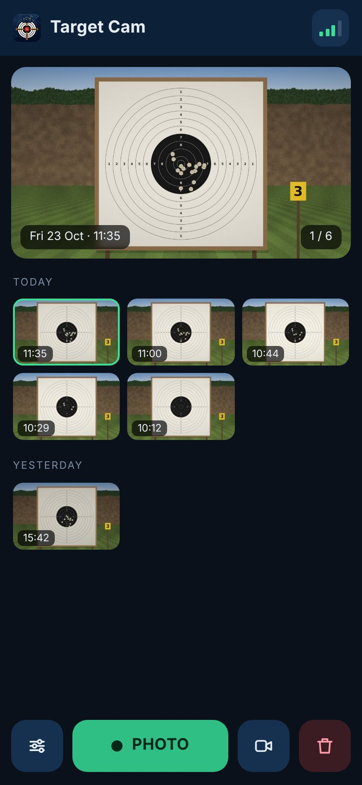
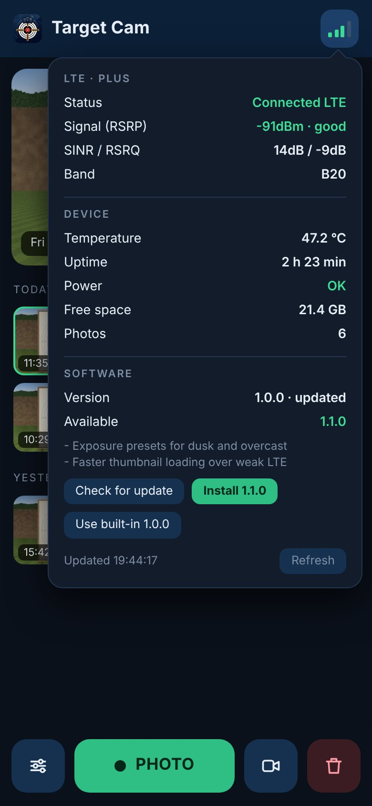
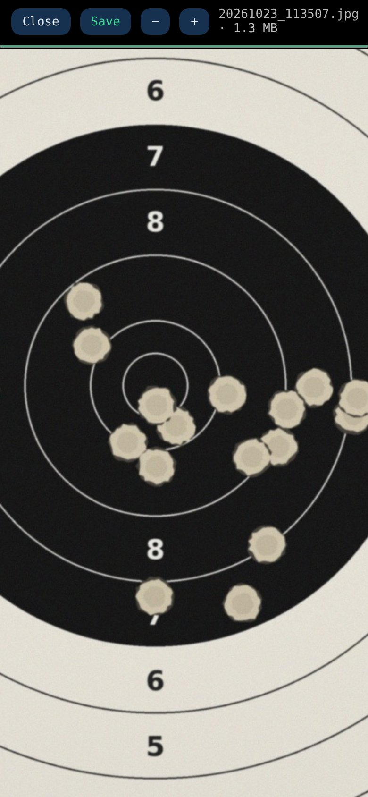

# Target Cam

A camera that sits next to a target on an outdoor range and sends photos of it to your phone, so you can see your hits without walking downrange or using a spotting scope.
It runs on a Raspberry Pi 3A+ with an IMX708 camera, gets online through a USB LTE modem, and is reached from anywhere over Tailscale.
The system is built to cope with having its power bank unplugged at any moment: the SD card is mounted read-only and everything that changes is written atomically.

<p align="center">
  
  
  
</p>

<sub>Screenshots show a made-up target.</sub>

## Features

- **Photo on demand.** One tap on **PHOTO** takes a full-resolution picture (automatic exposure, or set shutter and gain by hand).
  Previews and thumbnails are generated on the Pi, so browsing works over a weak LTE link, and the full-size file is only downloaded when you open it.
- **Gallery** of the latest photos grouped by day, with pinch, drag and double-tap zoom on the full-size image, plus save and delete.
  With the camera cropped to the target, the full-resolution photo is sharp enough to score hits to a tenth.
- **Live view** at 2 fps for aiming the camera and turning the focus ring, with a 1:1 sensor crop and a sharpness meter for fine focus. It stops by itself when nobody is watching, to save data and power.
- **Status at a glance.** The signal icon shows LTE quality. Its panel lists the operator, RSRP, SINR, band, Pi temperature, under-voltage and throttling, free space and the software version.
- **Installable web app** (PWA) for the phone home screen. There is nothing to install from an app store.
- **Survives power cuts.** The root filesystem is read-only, and photos and updates go to a separate `data` partition with atomic writes (see [Read-only system](#read-only-system-hardensh)).
- **Over-the-air updates** from GitHub Releases with automatic fallback to the last working version (see [Updates](#updates)).
- **Automatic cleanup.** Photos older than 14 days are deleted daily, but the newest 100 are always kept.

## Hardware

| Part | Notes |
|---|---|
| Raspberry Pi 3A+ | The only board tested so far. Others with a CSI camera connector and Raspberry Pi OS Bookworm are likely to work. |
| IMX708 camera module with a manual-focus lens | The software is tuned for the IMX708 sensor modes. A longer lens (e.g. M12 or CS mount) is what makes a distant target readable; focus is set by hand in live view. |
| USB LTE modem in HiLink mode | Shows up as a network interface with its web API at `192.168.8.1` (e.g. Huawei E3372h). Status data comes from that API. |
| microSD card, 16 GB or more | Holds the OS plus a separate ext4 partition labelled `data`. |
| USB power bank | The Pi 3A+ needs a stable 5 V / 2.5 A. The status panel warns about under-voltage. |

## Building a new device

1. **Flash Raspberry Pi OS Lite (Bookworm)** with Raspberry Pi Imager. Either 32-bit or 64-bit works; 32-bit is preferred, as it leaves more of the Pi 3A+'s 512 MB of RAM free. Set the user, Wi-Fi (for setup) and SSH there.
2. **Create the `data` partition.** The read-only setup needs an ext4 partition labelled `data` for photos and updates.
   The easiest way is from another Linux computer before the first boot, so the root partition is not expanded over the whole card:
   ```bash
   sudo parted /dev/sdX -- mkpart primary ext4 12GiB 100%   # leave room for the OS
   sudo mkfs.ext4 -L data /dev/sdX3
   ```
   If the root partition already fills the card, shrink it first (e.g. with GParted on another computer).
   On the Pi, `lsblk -f` should then show a partition with the label `data`.
3. **Install Tailscale** and log in (`curl -fsSL https://tailscale.com/install.sh | sh && sudo tailscale up`).
   In the Tailscale admin console, enable MagicDNS and HTTPS certificates, so the app gets a `https://<pi>.<tailnet>.ts.net` address.
4. **Install Target Cam** as the normal user:
   ```bash
   git clone https://github.com/krzysztofgw-pl/target-cam.git && cd target-cam
   bash install.sh
   ```
   This installs the Python dependencies (`python3-flask`, `python3-pil`), copies the app to `~/camera`, sets up the systemd units and publishes the app with `tailscale serve`.
5. **Point the camera at the target**, open the app and use live view to aim and focus.
   To crop each photo to the target, set a region of interest (see [Configuration](#configuration)).
6. **Make it power-cut proof:**
   ```bash
   sudo bash ~/harden.sh prepare   # move photos and Tailscale state to /data, volatile logs, watchdog
   sudo bash ~/harden.sh enable    # read-only root and /boot, then reboot
   ```

After the reboot, check with `findmnt -no FSTYPE /`, which should print `overlay`.

## Read-only system (`harden.sh`)

A Pi whose power is simply pulled can corrupt its SD card while it is writing.
`harden.sh` sets the system up so that nothing important is being written to the root filesystem at that moment.

| Command | What it does |
|---|---|
| `prepare` | Mounts the `data` partition at `/data` (`commit=5`, remounts read-only on errors, boot does not hang if it is missing). Moves the photos to `/data/target`, links them back to `~/target`, and moves the Tailscale state to `/data/tailscale` so the device keeps its identity. Creates `/data/app` for updates. Keeps the journal in RAM, turns off swap and enables the hardware watchdog (the Pi reboots itself if it hangs). The root is still writable after this step, so you can check that everything works. |
| `enable` | Turns on the overlay root (all changes to `/` go to RAM and are lost on reboot) and makes `/boot/firmware` read-only, then reboots. `/data` stays a real, writable mount. |
| `maintenance` | Turns the overlay off and makes the system writable again, then reboots. Use it for `apt upgrade`, changing systemd units or reinstalling with `install.sh`. Run `enable` again when you are done. |

Photo files are written to a temporary name, flushed and then renamed, so a power cut leaves either the whole photo or none. Empty leftovers are cleaned up at the next start.

## Configuration

The app reads environment variables from `target.service`. Change them with `sudo systemctl edit target` (in `maintenance` mode), then `sudo systemctl restart target`.

| Variable | Default | Meaning |
|---|---|---|
| `RPICAM_EXTRA` | | Extra `rpicam-still` options, e.g. a crop to the target: `--roi 0.3,0.3,0.4,0.4 --width 1843 --height 1037` |
| `HISTORY` | `24` | Number of photos shown in the gallery |
| `MODEM_URL` | `http://192.168.8.1` | HiLink modem web API |
| `LIVE_FPS`, `LIVE_W`, `LIVE_H` | `2`, `854`, `480` | Live view rate and size |
| `LIVE_IDLE`, `LIVE_MAX` | `20`, `600` | Live view stops after this many seconds without a viewer, or at the latest after this many seconds |
| `LIVE_EXTRA` | | Extra live view options, e.g. `--buffer-count 3` if the 1:1 zoom does not start on a Pi 3A+ |
| `UPDATE_CHECK` | `1` | `0` turns off the update check after boot |
| `UPDATE_REPO` | `krzysztofgw-pl/target-cam` | GitHub repository to take releases from (e.g. your fork) |
| `START_ATTEMPTS` | `3` | Failed starts before falling back to an older version |
| `HOST`, `PORT` | `127.0.0.1`, `8080` | Where the app listens. Tailscale serve forwards HTTPS to it |

Cleanup settings (`KEEP=100`, `DAYS=14`) are in `target-cleanup.service`.

## Updates

```
/  (read-only)   ~/camera/            built-in version and launcher.py
/data/app/       releases/<version>/  downloaded releases
                 current, previous    symlinks, switched atomically
                 state/               start attempts, last check result
```

- `target.service` runs `launcher.py`, which starts the release in `current`. If it fails to start 3 times in a row, the launcher switches to `previous`, and if that fails too, to the built-in version on the read-only root.
- A minute after boot, the app asks GitHub for the latest release. A new version appears in the device panel with its release notes and an **Install** button. Nothing is installed without a tap.
  The same panel has **Check for update** and **Back to …** to return to the previous or the built-in version.
- Installing downloads the archive, checks its sha256 and syntax, unpacks it next to the running version, switches the symlink and restarts the app (about 20 s). The root stays read-only, so `maintenance` mode is not needed.
- From the console: `python3 ~/camera/updater.py status|check|install [file.tar.gz]|rollback|legacy`, then `sudo systemctl restart target`. Installing from a file works without internet.

Updates only replace app files (`app.py`, `updater.py`, `static/`, `cleanup.sh`).
New apt packages, changes to systemd units or to `launcher.py` need `maintenance`, `install.sh` and `enable`, which also refreshes the built-in version.

If the release repository is private, put a fine-grained token with *Contents: Read-only* access in `/data/app/github_token`.

### Publishing a release

1. Change `VERSION` (e.g. `1.1.0`) and push or merge it to `main`.
2. The *Release* workflow runs the tests, builds `target-cam-1.1.0.tar.gz` with its `.sha256` and publishes release `v1.1.0`. The release notes are what the device shows before installing.

## Updating an older device

Devices installed before the update mechanism existed start `app.py` directly. Switch them over once:

```bash
sudo bash ~/harden.sh maintenance   # writable root, reboots
git clone https://github.com/krzysztofgw-pl/target-cam.git && cd target-cam
bash install.sh
sudo bash ~/harden.sh enable
```

## Development

```bash
python3 -m unittest discover -s tests   # updater and launcher, no Pi needed
```

CI runs the tests and starts the app through the launcher on every push and pull request.
